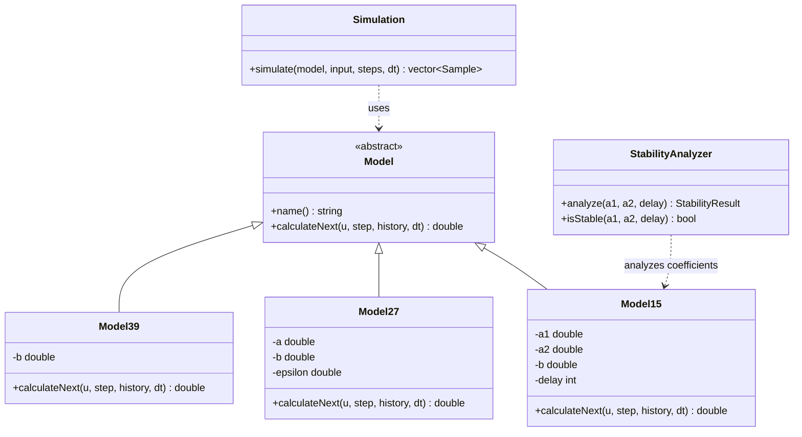

<p align="center">Министерство образования Республики Беларусь</p>
<p align="center">Учреждение образования</p>
<p align="center">«Брестский государственный технический университет»</p>
<p align="center">Кафедра ИИТ</p>

<br><br><br>

<p align="center"><b>ЛАБОРАТОРНАЯ РАБОТА № 2</b></p>
<p align="center"><b>По дисциплине: «Общая теория интеллектуальных систем»</b></p>
<p align="center"><b>Тема: «Модульное тестирование программы моделирования управляемого объекта»</b></p>

<br><br><br>

<p align="right">Выполнил:</p>
<p align="right">Студент 2 курса группы ИИ-29</p>
<p align="right">Евтеев М. Е.</p>
<p align="right">Проверил:</p>
<p align="right">Дворанинович Д. А.</p>

<br><br><br>

<p align="center">Брест 2026</p>

---

## 1. Цель работы

Освоить модульное тестирование программы на C++ с использованием **Google Test**, расширить программу лабораторной работы №1 модулем анализа устойчивости, настроить локальную автоматизацию сборки и запуска тестов, а также измерить покрытие исходного кода тестами.

## 2. Постановка задачи

В соответствии с заданием лабораторной работы №2 необходимо:

1. Написать модульные тесты для моделей, входных сигналов и модуля анализа устойчивости из лабораторной работы №1.
2. Использовать параметризованные тесты Google Test (`TEST_P`) для проверки расчётов на различных наборах данных.
3. Проверить устойчивость линейной дискретной модели по корням характеристического уравнения на Z-плоскости.
4. Реализовать предупреждение перед симуляцией, если модель неустойчива или анализ устойчивости не завершился успешно.
5. Использовать подмену входных сигналов для проверки разных режимов воздействия.
6. Создать `run_tests.bat` для автоматической конфигурации, сборки, запуска тестов и формирования отчёта покрытия.
7. Отразить количество тестов и фактическое покрытие кода в отчёте.

**Вариант 5.** В лабораторной работе используются модели:

- **Model 1.5** — линейная модель с задержкой;
- **Model 2.7** — релейная модель с гистерезисом;
- **Model 3.9** — нелинейная модель с функцией `tanh`.

## 3. UML-диаграмма классов

В лабораторной работе сохранена объектно-ориентированная структура моделей из ЛР №1. Базовый интерфейс `Model` используется для запуска моделей через общий механизм симуляции. Для анализа линейной модели добавлен отдельный класс `StabilityAnalyzer`.



## 4. Описание тестов

Тесты размещены в каталоге `test/` и сгруппированы по проверяемым компонентам.

| Файл | Количество тестовых запусков | Что проверяет |
|---|---:|---|
| `test_models.cpp` | 10 | Расчёт модели 1.5 на параметрах, задержка, релейные режимы модели 2.7, гистерезис, модель 3.9 и некорректные параметры |
| `test_signals_simulation.cpp` | 10 | Постоянный, импульсный и гармонический сигналы; параметризованные шаги симуляции; подмена входной функции; состояние покоя; проверка аргументов |
| `test_stability.cpp` | 6 | Устойчивые и неустойчивые корни, граничный случай единичной окружности, некорректные коэффициенты и задержка |
| **Итого** | **26** | — |

### Параметризованные тесты

В `test_models.cpp` используются тесты `TEST_P` для проверки расчёта модели 1.5 на нескольких наборах коэффициентов, задержки, входного сигнала и истории.

В `test_signals_simulation.cpp` параметризованный тест проверяет расчёт конечного значения симуляции для нескольких наборов параметров модели и входного воздействия. Это позволяет проверить шаги расчёта без дублирования тестового кода.

### Подмена входного сигнала

Симулятор принимает входную функцию. В тестах вместо стандартного сигнала передаётся lambda-функция, задающая последовательность входных значений. Так проверяется, что симуляция использует переданные значения и корректно рассчитывает выход модели.

## 5. Локальная автоматизация

Для локальной сборки и тестирования подготовлен командный файл **`run_tests.bat`**.

Скрипт выполняет следующие действия:

1. Проверяет наличие CMake, GCC/MinGW, `mingw32-make` и Python в `PATH`.
2. Конфигурирует проект с помощью CMake и генератора `MinGW Makefiles`.
3. Собирает основную программу и тесты.
4. Запускает тесты через CTest.
5. Устанавливает `gcovr`, если он доступен через Python package manager.
6. Формирует HTML-отчёт покрытия кода.

**Запуск из корня репозитория:**

```bat
run_tests.bat
```

**Запуск непосредственно из каталога лабораторной работы:**

```bat
trunk\ii02907\task_02\run_tests.bat
```

Для выполнения необходимы CMake, MinGW-w64 GCC, Python и подключение к интернету для загрузки Google Test и установки gcovr.

## 6. Тестовое покрытие и результаты

- **Способ запуска:** локальный скрипт `run_tests.bat`
- **Всего тестовых запусков:** 26
- **Успешно пройденных тестов:** заполняется после фактического локального запуска
- **Инструмент покрытия:** gcovr

| Модуль / класс | Покрытие строк (Line Coverage) | Покрытие функций (Function Coverage) | Статус |
|---|---:|---:|---|
| `Model15` | ожидает измерения | ожидает измерения | — |
| `Model27` | ожидает измерения | ожидает измерения | — |
| `Model39` | ожидает измерения | ожидает измерения | — |
| `InputSignal` / `Simulation` | ожидает измерения | ожидает измерения | — |
| `StabilityAnalyzer` | ожидает измерения | ожидает измерения | — |
| **Итоговый результат** | **не измерено** | **не измерено** | **ожидает локального запуска** |

После выполнения скрипта фактические значения покрытия и результат запуска необходимо внести в таблицу. Проценты покрытия заранее не указываются, чтобы не подменять реальные результаты.

### Скриншоты выполнения

После локального запуска сюда добавляются:

- скриншот успешного выполнения `run_tests.bat`;
- скриншот HTML-отчёта gcovr;
- при необходимости — скриншот тестового набора Google Test.

Файлы скриншотов будут размещены в каталоге `doc/screenshots/`.

## 7. Выводы

В ходе лабораторной работы подготовлены модульные тесты для математических моделей варианта 5, входных сигналов, симуляции и анализатора устойчивости. Для проверки различных наборов параметров применены параметризованные тесты Google Test. Для тестирования входных воздействий предусмотрена подмена входной функции.

Разработан локальный сценарий автоматизации сборки и запуска тестов с формированием отчёта покрытия gcovr. После выполнения сценария на локальном компьютере в отчёт будут внесены фактические результаты тестирования и измеренное покрытие.

**Цель работы будет подтверждена после успешного локального запуска тестов и фиксации результатов покрытия.**
